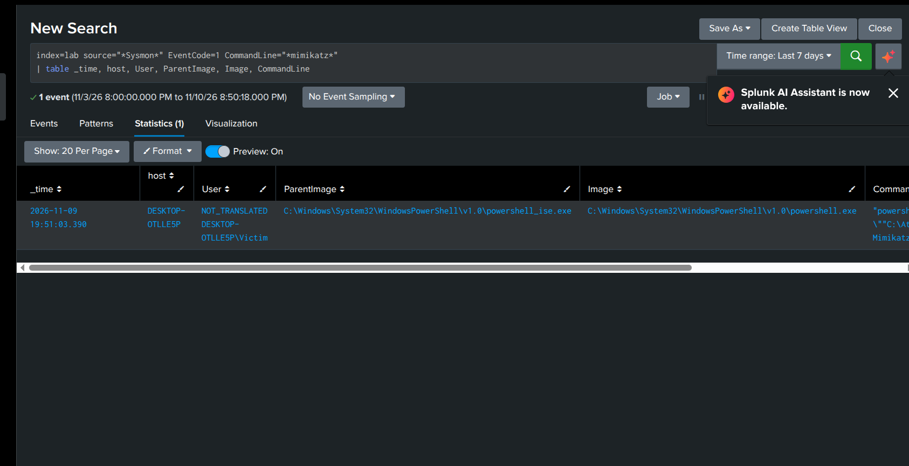
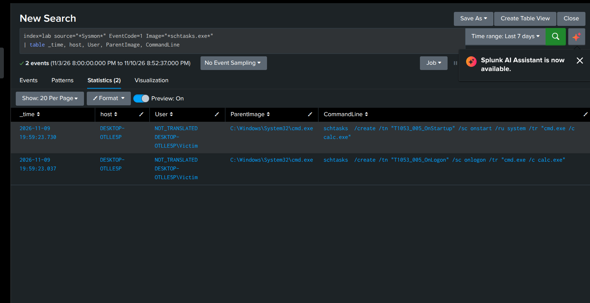
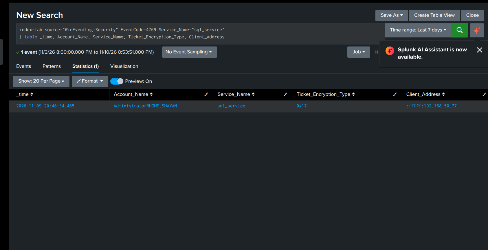
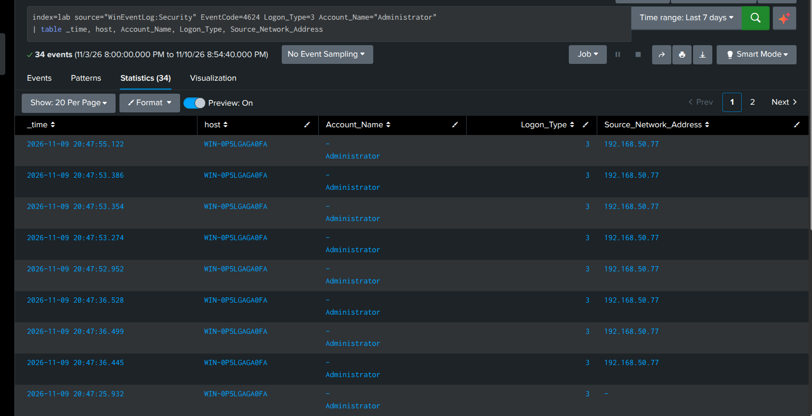
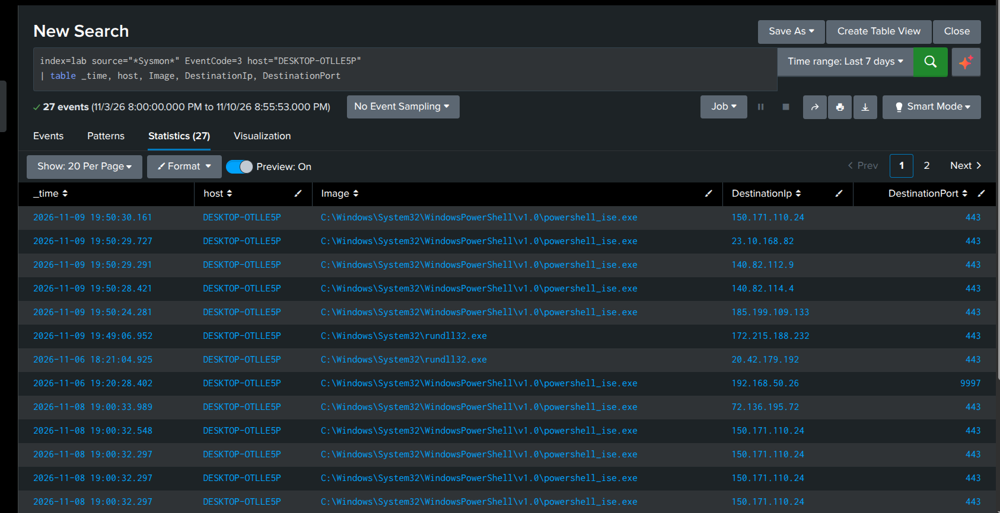

# Active Directory Attack & Detection Lab

I ran an attack on one of my workstations on my home lab, and then switched hats and investigated the whole thing in Splunk as a SOC analyst. This repo is my write-up of what the attack looked like and how I caught each step in the logs.

The attack steps were generated with [Atomic Red Team](https://github.com/redcanaryco/atomic-red-team) and mapped to [MITRE ATT&CK](https://attack.mitre.org/).

## The setup

Three machines:

- A **Domain Controller** (`WIN-0P5LGAGA0FA`) running Active Directory for the domain `home.shayan`.
- A **Windows 11 workstation** (`DESKTOP-OTLLE5P`) joined to the domain. This is the "employee" machine the attacker lands on.
- An **Ubuntu box** running Splunk as the SIEM, collecting everything.

For logging, I installed Sysmon (with the SwiftOnSecurity config) and forwarded both Sysmon and Windows Security logs into Splunk using the Universal Forwarder. Everything lands in `index=lab`. Getting this pipeline working was honestly the hardest part. Forwarder permissions, the right event channels, all of it.

## The scenario

In my story, I targeted the most vulnerable entity in an organization, humans: an employee gets phished, the attacker lands on their workstation, sets up a way to stick around after reboots, steals a service account's password through Kerberoasting, reuses credentials to move toward the Domain Controller, and tries to steal data on the way out.

Here's each step and how I found it.

## 1. The foothold

The attack starts with a malicious PowerShell command on the workstation. Standing in for an employee opening a phishing attachment. In my test it tried to run Mimikatz.

I found it with Sysmon process-creation events (Event ID 1) where the command line mentions Mimikatz:

```
index=lab source="*Sysmon*" EventCode=1 CommandLine="*mimikatz*"
| table _time, host, User, ParentImage, Image, CommandLine
```



One thing worth pointing out: the parent process here is PowerShell ISE because that's what I launched it from. In a real phishing case the parent would be Word or Outlook, and seeing Word spawn PowerShell to run Mimikatz is exactly the kind of chain you'd alert on.

## 2. Persistence

Next the attacker plants scheduled tasks so their code runs again after a reboot. One at startup, one at logon, one of them as SYSTEM.

Caught it by looking for `schtasks.exe` creating tasks:

```
index=lab source="*Sysmon*" EventCode=1 Image="*schtasks.exe*"
| table _time, host, User, ParentImage, CommandLine
```



Tasks that fire at startup or logon, especially running as SYSTEM, are a pretty classic persistence move.

## 3. Kerberoasting

This was the one I most wanted to catch. The attacker asks the Domain Controller for the service ticket of a weak account (`sql_service`) so they can crack its password offline.

```
index=lab source="WinEventLog:Security" EventCode=4769 Service_Name="sql_service"
| table _time, Account_Name, Service_Name, Ticket_Encryption_Type, Client_Address
```



Two things give it away in that one event: the ticket is for a regular user account (not a computer account ending in `$`), and the encryption type is `0x17` — weak RC4, which attackers specifically want because it's crackable. And the request came from the workstation's IP, which ties it back to the compromised machine.

Getting this to show up actually took a second attempt. My first run didn't target the right account, so nothing showed. Pivoting and re-checking is part of the job.

## 4. Lateral movement

Then the attacker uses the Administrator account to log in across the network from the workstation toward the DC.

```
index=lab source="WinEventLog:Security" EventCode=4624 Logon_Type=3 Account_Name="Administrator"
| table _time, host, Account_Name, Logon_Type, Source_Network_Address
```



Logon Type 3 is a network logon. A privileged account doing network logons *from a workstation* instead of a proper admin console is a strong sign of stolen credentials being reused.

## 5. Exfiltration

The last step was trying to steal the fake sensitive file I'd planted. I went looking for outbound network connections from the workstation:

```
index=lab source="*Sysmon*" EventCode=3 host="DESKTOP-OTLLE5P"
| table _time, host, Image, DestinationIp, DestinationPort
```



I couldn't isolate a clean "data left the building" event here. The outbound traffic I saw lines up with the attack tooling downloading things, not an obvious exfil.

## What caused all this

The core problem was a service account with a weak password and an SPN, which made Kerberoasting possible, plus it still allowed RC4 encryption. From there, reused credentials let the attacker move toward the DC.

## What I'd recommend fixing

- Train end users on phishing emails.
- Give service accounts long managed passwords (gMSA) and turn off RC4.
- Alert on Kerberoast-style 4769 events (user account + RC4).
- Don't let Domain Admin accounts log into workstations.
- Add network or DNS monitoring to catch exfiltration, which I couldn't see here.
- Watch for scheduled tasks set to run at startup/logon as SYSTEM.

## What I got out of it

Building the Sysmon → forwarder → Splunk pipeline from scratch, writing SPL to hunt specific techniques, and getting used to the real rhythm of investigating. Forming a theory, having it not pan out, and pivoting until the evidence lines up. The gaps taught me as much as the catches.
